<div align="center">

# 🧹 ST-Cleaner

**Trung tâm dọn dẹp dữ liệu toàn diện và chẩn đoán sức khỏe khởi động cho SillyTavern**

Không phụ thuộc thư viện bên thứ ba · Khởi động nguội chỉ `2.2 KB` · Bao phủ 9 danh mục lớn & 30 loại tài sản · Lọc thẻ đa chiều & bảo vệ chống xóa nhầm nền tảng cốt lõi

[](https://github.com/SillyTavern/SillyTavern)
[](#-bảo-vệ-nền-tảng-cốt-lõi--chống-xóa-nhầm-khi-chọn-tất-cả)
[](#-vì-sao-nên-chọn-st-cleaner)
[](#-xem-trước-giao-diện-thực-tế)
[](./LICENSE)

[Điểm nổi bật](#-vì-sao-nên-chọn-st-cleaner) • [Xem trước giao diện](#-xem-trước-giao-diện-thực-tế) • [Cài đặt nhanh](#-cài-đặt-nhanh) • [Hướng dẫn 4 bước](#-hướng-dẫn-sử-dụng-trong-4-bước) • [Phạm vi dọn dẹp](#-phạm-vi-hỗ-trợ-dọn-dẹp-9-nhóm-lớn--30-mục-con) • [Cơ chế bảo vệ cốt lõi](#-bảo-vệ-nền-tảng-cốt-lõi--chống-xóa-nhầm-khi-chọn-tất-cả) • [Câu hỏi thường gặp](#-câu-hỏi-thường-gặp-faq) • [Giấy phép phi thương mại](#-giấy-phép-sử-dụng-non-commercial-license)

</div>

---

## 💡 Vì sao nên chọn ST-Cleaner?

Sau thời gian dài sử dụng SillyTavern ở cường độ cao, thư mục dữ liệu thường tích tụ hàng trăm thẻ nhân vật thử nghiệm, hàng trăm MB gói Sprite biểu cảm, các phiên chat thử ngắn, Worldbook chưa gắn kết, Regex đã tắt, **script cũ của TavernHelper (`JS-Slash-Runner`)** cùng hơn 120 mẫu Preset trộn lẫn với nhau. Điều này không chỉ khiến **thời gian tải màn hình đầu ngày càng chậm, tìm thẻ mất công, điện thoại chạy Termux bị căng RAM**, mà việc dọn thủ công còn gặp 3 vấn đề lớn: **khó phân biệt mục tự tạo với mục mặc định của ST**, **sợ xóa nhầm nền tảng cốt lõi làm SillyTavern báo lỗi**, và **xóa tệp xong vẫn để lại hàng loạt tham chiếu hỏng**.

**`ST-Cleaner`** được thiết kế như một công cụ quản gia gọn nhẹ cho SillyTavern để giải quyết triệt để vấn đề đó:

- ⚡ **Tàng hình khi không dùng, không tạo gánh nặng khởi động**: Điểm vào khởi động nguội chỉ **`2.2 KB`**, không phụ thuộc thư viện bên thứ ba; chỉ tải động các mô-đun quét và giao diện khi bạn mở bảng điều khiển, đóng cửa sổ sẽ hủy ngay DOM và bộ đệm chỉ mục trong bộ nhớ.
- 🩺 **Chẩn đoán thời gian khởi động & kiểm tra sức khỏe chuyên sâu**: Dựa trên `Navigation Timing` + `Resource Timing` để tính điểm sức khỏe `0-100`, đo `TTFB`, thời điểm DOM sẵn sàng, dung lượng truyền tải song song, xu hướng 6 lần khởi động gần nhất và **bảng xếp hạng Top yêu cầu chậm nhất**; hỗ trợ **"Kiểm tra chuyên sâu"** tự động tìm ra Worldbook nhàn rỗi, script đã tắt, phiên chat thử nghiệm ≤2 tin nhắn và tệp mồ côi dư thừa, nhấn một lần là đi thẳng tới khu vực dọn tương ứng.
- 🏷️ **Thanh thẻ lọc đa chiều cấp hai (`Facet Bar`) + 7 kiểu sắp xếp hiệu năng cao**: Hỗ trợ lọc tức thì theo **`#tag` nhân vật, `★ Yêu thích`, trạng thái nhàn rỗi, 5 phạm vi gắn kết Worldbook, tự tạo vs mặc định của ST, thư mục con thư viện ảnh**; tích hợp 7 kiểu sắp xếp (**Mặc định / Ưu tiên nhàn rỗi dễ xóa / Tên tự nhiên `A↔Z` / Thời gian mới nhất hoặc cũ nhất / Ưu tiên dung lượng hoặc số mục**). Danh sách hàng vạn mục vẫn chỉ dựng cố định khoảng 30 nút ảo (virtual nodes), thời gian sắp xếp lại `< 15ms`.
- 🔤 **Tìm nhanh theo Pinyin đầy đủ & chữ cái đầu**: Tích hợp sẵn bộ chỉ mục Pinyin gọn nhẹ (hỗ trợ bộ chữ GB2312 cấp 1 và các chữ thường gặp trong roleplay), gõ `kl`, `fll`, `jgzs` là định vị ngay các mục tiếng Trung.
- 🛡️ **Bảo vệ nền tảng cốt lõi ở mức mã nguồn & tự động dọn tham chiếu**: Đối chiếu cơ chế `content.log` của SillyTavern (tài sản mặc định sau khi xóa sẽ **không** tự tạo lại khi khởi động lại), tự động gắn nhãn nổi bật **`⚠️ Nền tảng cốt lõi`** và mặc định đưa vào danh sách bỏ qua bảo vệ cho các Preset dự phòng, Persona mặc định, giao diện/Quick Reply mặc định và các tiện ích hệ sinh thái cốt lõi như **TavernHelper / Prompt Template / LittleWhiteBox**; ở giai đoạn lưu đĩa sẽ tự động gỡ sạch tham chiếu dư thừa ở nhóm chat, thẻ tag, Persona và danh sách trắng script.

---

## 🖼️ Xem trước giao diện thực tế

### 1. Tổng quan dữ liệu, phân tích hiệu năng khởi động & Kiểm tra chuyên sâu
Lưới 9 ô tông màu Morandi dịu mắt tổng hợp quy mô tài sản toàn hệ thống, phía dưới tích hợp **điểm sức khỏe (hạng A~D)**, các thẻ thông số màn hình đầu (`TTFB / DOM / Tải tài nguyên / TB 6 lần gần nhất`) và bảng chẩn đoán 3 tab **"Hiệu năng khởi động / Gợi ý tối ưu / Chi tiết tải chậm"** (góc trên bên phải hỗ trợ chuyển nhanh **Chế độ Sáng / Tối**):

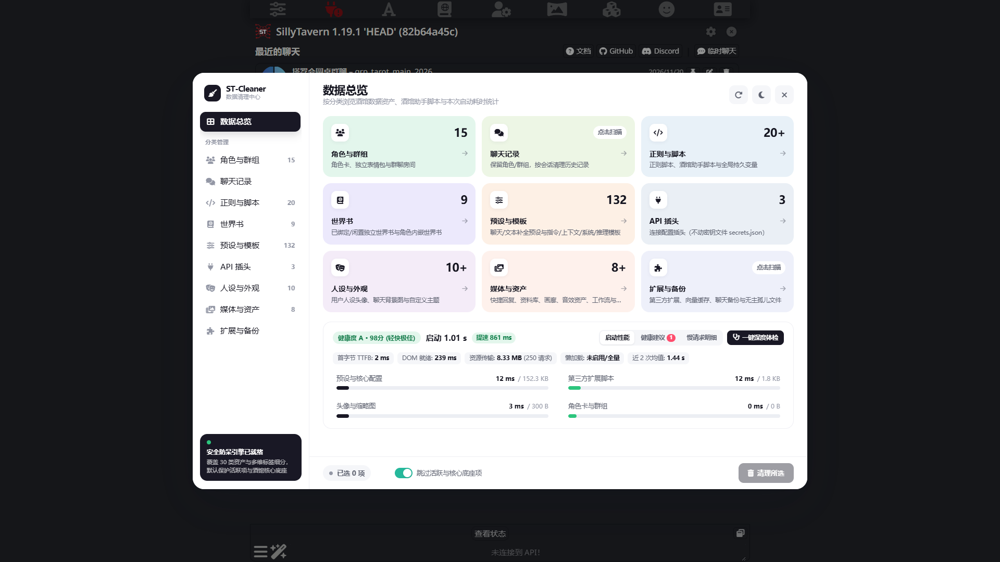

Sau khi nhấn **"Kiểm tra chuyên sâu"**, công cụ tự động quét tài sản dư thừa toàn hệ thống và tạo danh sách gợi ý dọn dẹp thông minh, nhấn vào là chuyển thẳng tới đúng bộ lọc chi tiết:

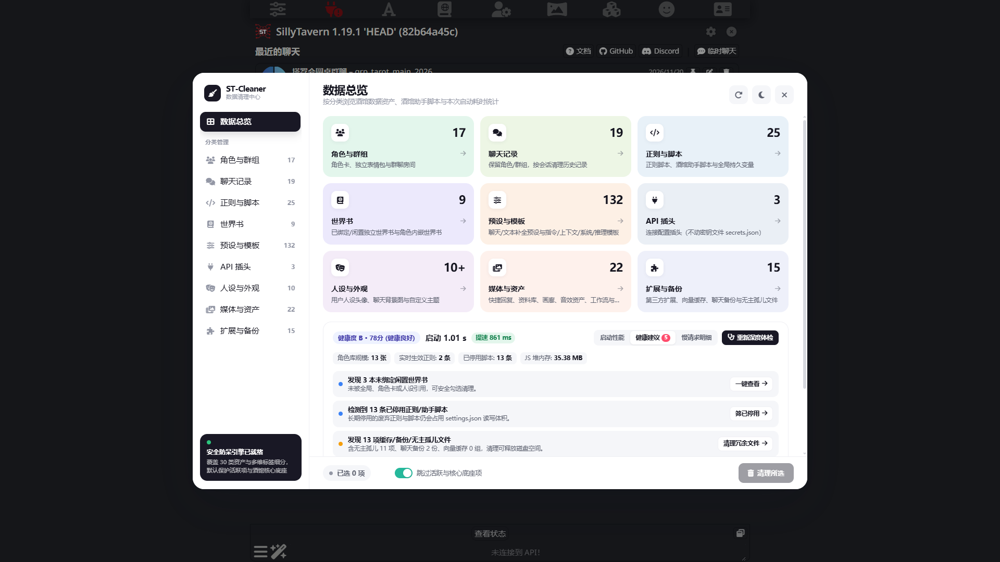

### 2. Thanh thẻ lọc đa chiều (`Facet Bar`) & 7 kiểu sắp xếp danh sách
Tự động trích xuất các thẻ lọc cấp hai như **`#tag nhân vật`, `★ Yêu thích`, `Nhàn rỗi/Không nhóm`, `Nhân vật mặc định ST`** trong các mục Nhân vật, Worldbook, Lịch sử chat, Preset... kết hợp hộp chọn **7 kiểu sắp xếp** bên phải thanh tìm kiếm để lọc nhanh bản lưu cũ nhàn rỗi:

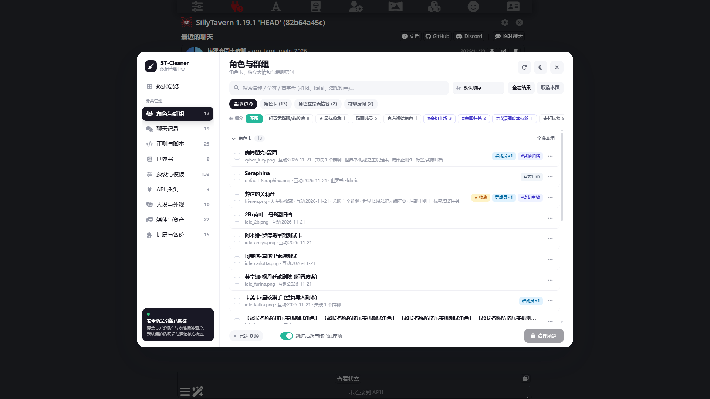

### 3. Đánh dấu nổi bật nền tảng cốt lõi (`⚠️ Nền tảng cốt lõi`) & tách biệt mục mặc định
Trước hơn 130 mẫu Preset, chỉ cần nhấn **"Preset tự tạo"** để ẩn toàn bộ hơn 120 mẫu mặc định; mọi thành phần cốt lõi nếu xóa sạch sẽ gây lỗi bảng hoặc mất đường quay lại đều được đánh dấu bằng **viền đỏ cảnh báo bên trái + huy hiệu `⚠️ Nền tảng cốt lõi`** và mặc định khóa bảo vệ:

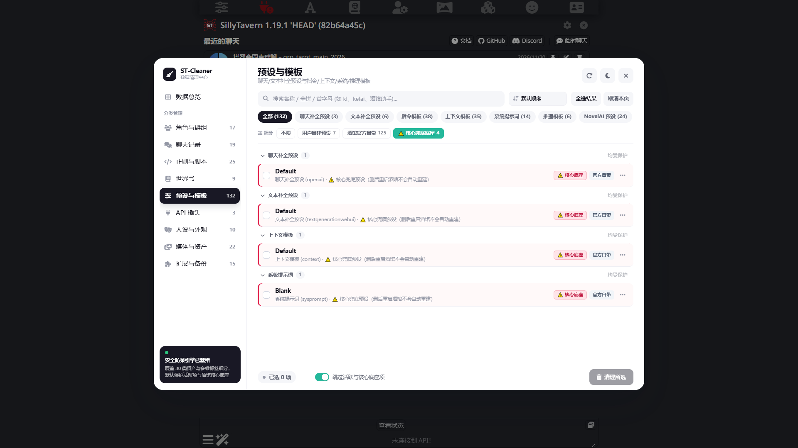

### 4. Quản lý tinh gọn Regex, script TavernHelper & Workflow tạo ảnh
Nhận diện đầy đủ Regex toàn cục/nhân vật/Preset, **script phân cấp thư mục của TavernHelper**, **biến toàn cục STscript**, bộ Quick Reply, thư mục con thư viện ảnh, tài nguyên âm thanh và workflow ComfyUI tùy chỉnh:

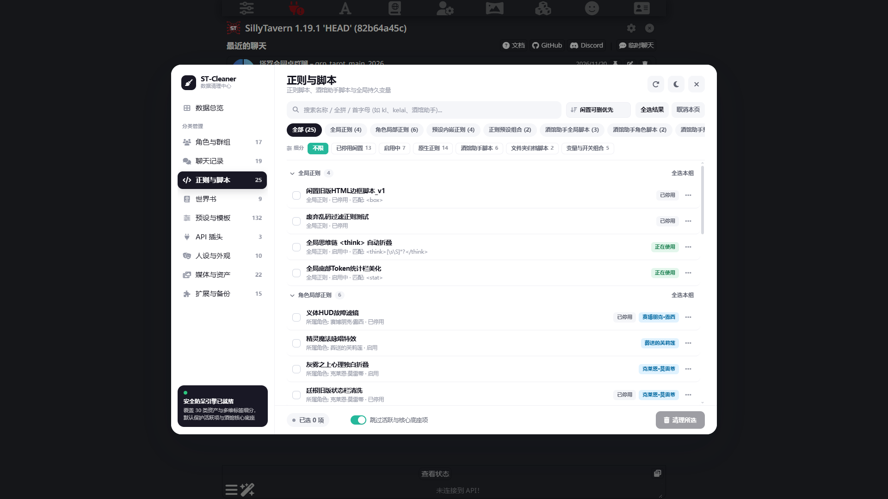

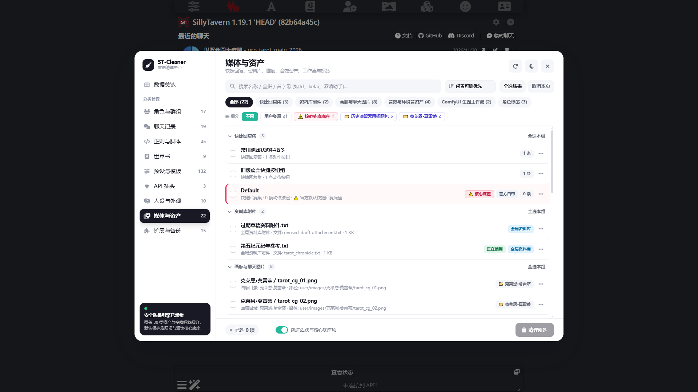

### 5. Ngăn xác nhận an toàn 2 lớp & cảnh báo rủi ro cao cho nền tảng cốt lõi
Trước khi dọn sẽ tự động tạo bảng tổng hợp đối chiếu xuyên danh mục; nếu người dùng chủ động tắt công tắc bảo vệ phía dưới và chọn mục `⚠️ Nền tảng cốt lõi`, đỉnh hộp thoại xác nhận sẽ hiện **khung cảnh báo đỏ rủi ro cao** liệt kê từng nguyên nhân rủi ro và lưu ý `content.log` không tự khôi phục:

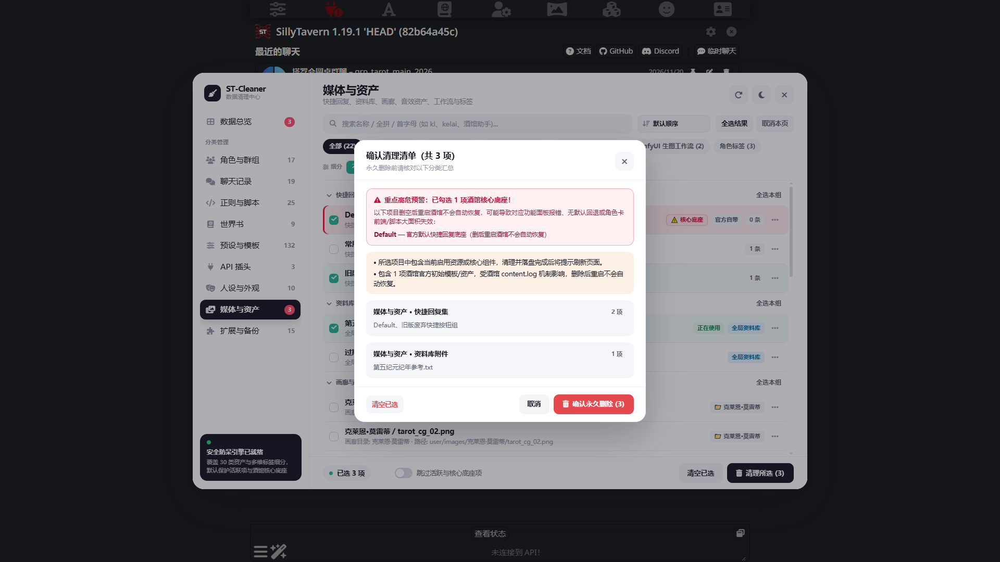

### 6. Hai lối mở nhanh & tương tác ngăn kéo tự nhiên trên di động
Đã kiểm thử thực tế trên 4 độ phân giải máy tính (`1366×768`, `1600×900`, `1920×1080`, `2560×1440`), máy tính bảng `820×1180` và điện thoại / Android Termux `390×844`. Bản di động dùng kiến trúc tương tác tự nhiên như ứng dụng (không bị cắt thanh cuộn ngang): trang tổng quan hiển thị trọn vẹn lưới 9 ô và trung tâm kiểm tra; khu vực danh mục có **`‹ Tổng quan` + `Tên danh mục ▾`** mở lưới chuyển nhanh 9 danh mục, cùng **thanh tìm kiếm 2 hàng + nút `Lọc`** mở ngăn kéo đáy trải phẳng nhiều hàng, hiển thị đầy đủ 100% danh mục con, thẻ lọc và kiểu sắp xếp:

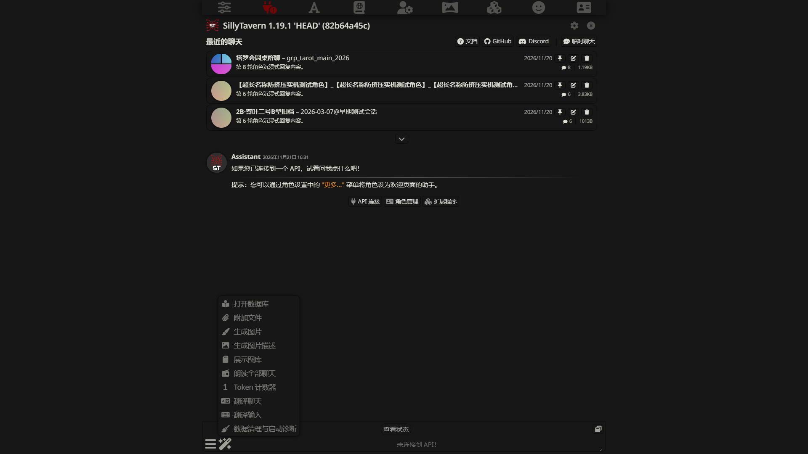

<div align="center">
  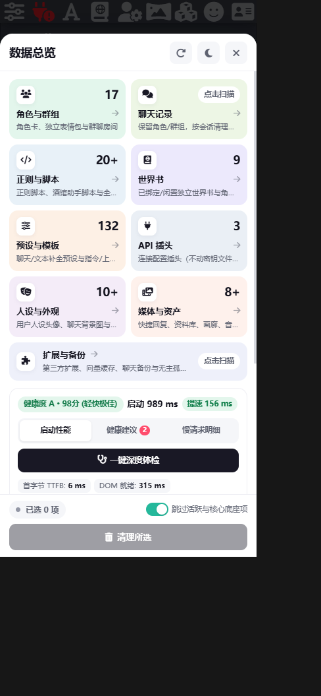
  &nbsp;&nbsp;
  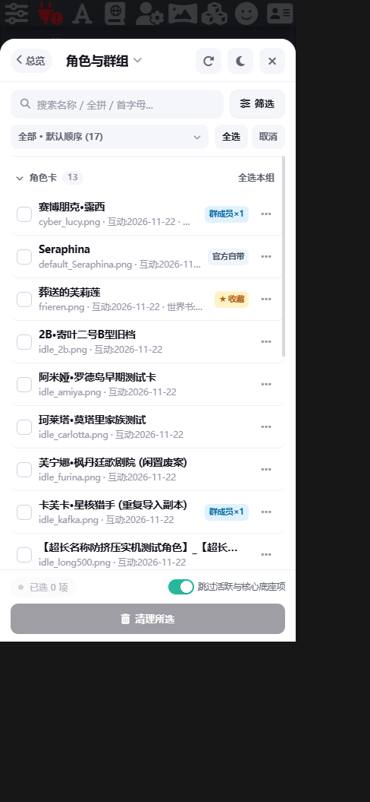
</div>
<br />
<div align="center">
  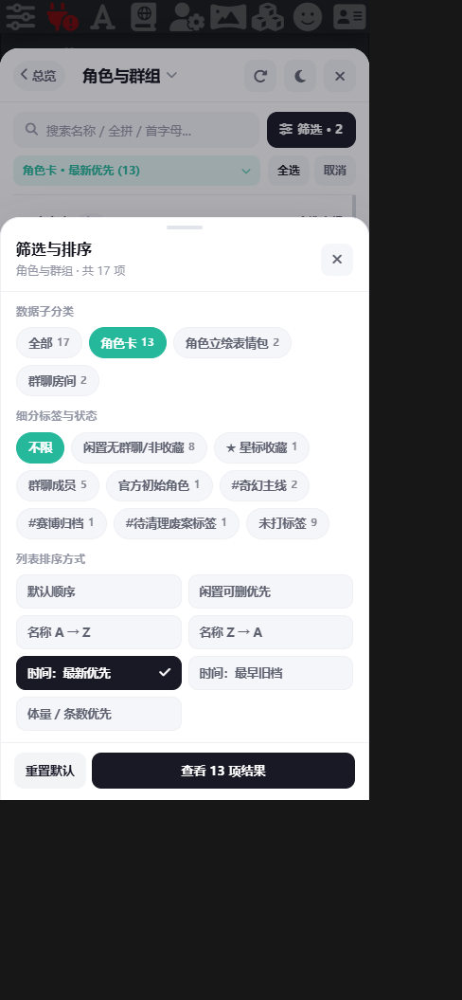
  &nbsp;&nbsp;
  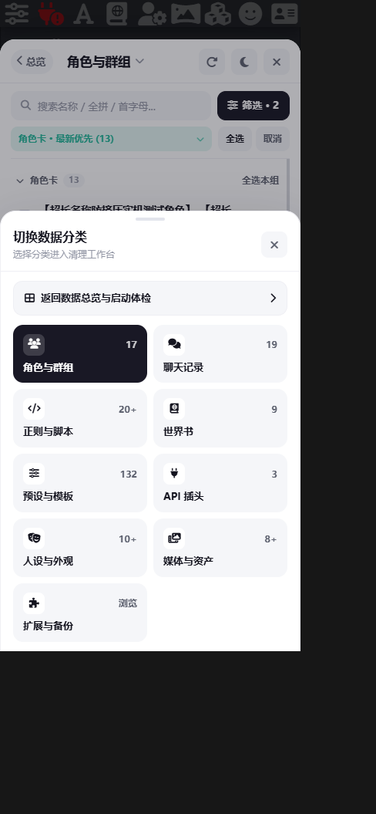
</div>

---

## 🚀 Cài đặt nhanh

### Cách 1: Cài đặt trực tiếp trong giao diện SillyTavern (Khuyến nghị)

1. Nhấn vào mục **Extensions** (biểu tượng khối xếp hình) trên thanh điều hướng phía trên của SillyTavern.
2. Nhấn **Install extension**.
3. Dán đường dẫn kho lưu trữ:
   ```text
   https://github.com/Despolca/STCleaner
   ```
4. Xác nhận cài đặt rồi tải lại trang trình duyệt để sử dụng.

### Cách 2: Clone bằng dòng lệnh (Máy tính / Android Termux)

```bash
cd SillyTavern/data/default-user/extensions
git clone https://github.com/Despolca/STCleaner
```

Sau khi clone xong, tải lại trang SillyTavern là có hiệu lực.

---

## 📘 Hướng dẫn sử dụng trong 4 bước

1. **Mở bảng điều khiển**
   - **Lối tắt nhanh**: Nhấn vào **biểu tượng Đũa phép (`✨`)** ở góc dưới bên trái khung nhập chat → chọn **"Dọn dẹp dữ liệu & Chẩn đoán khởi động"**.
   - **Cài đặt trong mục Extensions**: Mở **Extensions** trên thanh công cụ → mở rộng **"Dọn dẹp dữ liệu & Chẩn đoán khởi động (ST-Cleaner)"** để bật/tắt tiện ích, ẩn riêng nút Đũa phép hoặc tắt/bật đo thời gian khởi động ngầm.
2. **Kiểm tra tổng quan & tìm yêu cầu tải chậm**
   - Trung tâm chẩn đoán dưới trang chủ mặc định hiển thị tổng thời gian khởi động, phân tích từng giai đoạn và mức chênh lệch tốc độ; có thể chuyển sang tab **"Chi tiết tải chậm"** để tìm tài nguyên nặng làm chậm khởi động, hoặc nhấn **"Kiểm tra chuyên sâu"** để nhận gợi ý dọn dẹp và đi thẳng tới danh mục tương ứng.
3. **Thẻ lọc chi tiết + 7 kiểu sắp xếp + Tìm nhanh Pinyin**
   - Chọn nhóm cấp 1 (như `Thẻ nhân vật`, `Worldbook độc lập`, `Preset Chat Completion`), sau đó dùng thanh **"Lọc chi tiết"** bên dưới để khoanh vùng chính xác theo `#tag`, `Preset tự tạo`, `Nhàn rỗi dễ xóa`, `Bản thử cực ngắn (≤2 tin)`...
   - Hộp sắp xếp bên phải cho phép chuyển nhanh giữa **`Ưu tiên nhàn rỗi dễ xóa`, `Tên A→Z / Z→A`, `Mới nhất / Cũ nhất`, `Ưu tiên dung lượng / số mục`**; ô tìm kiếm hỗ trợ tên, tên tệp tiếng Anh, Pinyin đầy đủ và chữ cái đầu nhiều từ khóa.
4. **Chọn xuyên danh mục & dọn dẹp an toàn**
   - Có thể tự do chuyển qua lại giữa các danh mục để chọn (thanh bên trái hiện huy hiệu đỏ đếm số mục chờ xóa theo thời gian thực); phía dưới mặc định bật **"Bỏ qua mục đang dùng & cốt lõi"**.
   - Nhấn **"Dọn mục đã chọn"** ở góc dưới bên phải để kiểm tra danh sách xác nhận; sau khi xác nhận, hệ thống tự động chạy quy trình 3 bước **Xóa song song tệp có giới hạn luồng → Gộp ghi lại cùng nguồn → Gỡ tham chiếu & lưu đĩa**, sau đó hiển thị báo cáo chi tiết Thành công / Bỏ qua / Lỗi.

---

## 🗂️ Phạm vi hỗ trợ dọn dẹp (9 nhóm lớn · 30 mục con)

| Danh mục | Mục con hỗ trợ | Bộ lọc chi tiết & Thiết kế chống xóa nhầm |
| :--- | :--- | :--- |
| **1. Nhân vật & Nhóm chat** | Thẻ nhân vật, **Sprite biểu cảm nhân vật (`Sprites`)**, Phòng chat nhóm | Lọc: `Nhàn rỗi/Không nhóm/Chưa thích`, `★ Yêu thích`, `Thành viên nhóm chat`, `Nhân vật mặc định ST`, `#tag` động, `Chưa gắn tag`. Hỗ trợ chỉ xóa Sprite mà giữ lại thẻ nhân vật; xóa thẻ tự động gỡ tham chiếu nhóm/tag/Persona/`charLore`/TavernHelper, **tuyệt đối không xóa dây chuyền Worldbook hoặc Preset dùng chung**. |
| **2. Lịch sử chat** | Phiên chat đơn nhân vật, Phiên chat nhóm | Lọc: `Nhánh lịch sử cũ`, `Bản thử cực ngắn (≤2 tin)`, `Phiên chính của từng nhân vật`, kế thừa `#tag` nhân vật. Giữ nguyên nhân vật và nhóm chat, chỉ xóa tệp `.jsonl` đã chọn và dọn liên kết vector/tệp đính kèm phiên chat. |
| **3. Regex & Script** | Regex toàn cục/nhân vật/Preset, Bộ tổ hợp Regex, **Script toàn cục/nhân vật/Preset của TavernHelper**, **Biến script toàn cục ST** | Lọc: `Đã tắt / Nhàn rỗi`, `Đang bật`, `Regex gốc ST`, `Script TavernHelper`, `Script trong thư mục`, `Biến & Tổ hợp bật/tắt`. Tương thích đầy đủ cây script và cấu trúc thư mục TavernHelper v3/v4. |
| **4. Worldbook** | Worldbook nhàn rỗi chưa gắn, Worldbook độc lập đã gắn, Worldbook nhúng trong nhân vật | Lọc: `Nhàn rỗi chưa gắn`, `Bật toàn cục thường trực`, `Worldbook chính nhân vật`, `Worldbook phụ trợ nhân vật`, `Gắn Persona/Phiên chat`, `Nhúng trong thẻ nhân vật`, `Tự tạo / Mặc định ST`, kế thừa `#tag`. Xóa Worldbook độc lập tự động gỡ tham chiếu đa phạm vi; dọn sách nhúng chỉ làm trống `character_book`. |
| **5. Preset & Template** | OpenAI, TextGen, Instruct, Context, SysPrompt, Reasoning, NovelAI, KoboldAI | Lọc: `Preset tự tạo`, `Mặc định của ST`, `⚠️ Nền tảng dự phòng cốt lõi`. Tách biệt chỉ bằng một cú nhấn giữa Preset tự tạo và hơn 100 mẫu mặc định, bảo vệ nền tảng dự phòng của từng engine. |
| **6. Cấu hình API** | Hồ sơ kết nối (`Connection Profiles`) | Gắn nhãn cảnh báo `⚠️ Có URL kết nối` (chỉ gỡ địa chỉ proxy và liên kết model, **tuyệt đối không đọc hay đụng tới tệp khóa API `secrets.json`**). |
| **7. Persona & Giao diện** | Persona người dùng (`Personas`), Hình nền chat, Giao diện tùy chỉnh | Lọc: `Tự tạo / Tải lên`, `Mặc định của ST`, `Hình nền động`, `⚠️ Nền tảng dự phòng cốt lõi`. Loại trừ cứng hình nền trong suốt `__transparent.png`, mặc định bảo vệ `user-default.png` và giao diện `Dark Lite`. |
| **8. Media & Tài nguyên** | Quick Reply, Tệp đính kèm Data Bank, Thư viện ảnh, **Tài nguyên âm thanh**, **Workflow ComfyUI**, Thẻ tag nhân vật | Lọc: `Tài nguyên người dùng`, `⚠️ Nền tảng dự phòng cốt lõi`, `Tag trống không có nhân vật`, `📁 Thư mục con thư viện ảnh` động. Bảo vệ bộ Quick Reply mặc định `Default`, tự động ẩn workflow tạo ảnh mặc định tích hợp sẵn. |
| **9. Tiện ích & Sao lưu** | Tiện ích bên thứ ba, Vector Cache (`Vectors`), Sao lưu chat tự động, Tệp mồ côi `Data Maid` | Lọc: `Tiện ích bên thứ ba`, `Tiện ích đã tắt`, `⚠️ Nền tảng hệ sinh thái cốt lõi`, `Cache / Sao lưu / Tệp mồ côi`. Mặc định bảo vệ các tiện ích nền tảng như TavernHelper/Prompt Template/LittleWhiteBox/MemoryBooks, loại trừ nghiêm ngặt bản chụp `settings.json`. |

---

## 🛡️ Bảo vệ nền tảng cốt lõi & Chống xóa nhầm khi chọn tất cả

Để trả lời câu hỏi an toàn cốt lõi: **"Nếu chọn tất cả và xóa sạch trong danh sách thì SillyTavern có còn chạy bình thường không?"**, `ST-Cleaner` kết hợp cơ chế mã nguồn máy chủ SillyTavern (`seedContent` và cơ chế ghi nhận lần đầu `content.log` — **tài sản mặc định một khi đã xóa sẽ không tự tạo lại khi khởi động lại ST**) để xây dựng 4 lớp phòng vệ:

1. **Ẩn và chặn cứng các tài sản dự phòng hệ thống**:
   - Tiện ích lõi tích hợp sẵn, chính `ST-Cleaner`, tệp khóa `secrets.json`, tệp `settings.json` gốc, workflow ComfyUI mặc định và hình nền trong suốt **`__transparent.png`** được hardcode ở frontend đều bị ẩn ở tầng quét và chặn cứng thêm lần nữa ở tầng xóa, không thể xóa trong bất kỳ trường hợp nào.
2. **Đánh dấu trực quan `⚠️ Nền tảng cốt lõi` & mặc định khóa bảo vệ**:
   - Các mục nếu xóa sạch sẽ khiến frontend SillyTavern báo lỗi, mất điểm dự phòng hoặc làm hỏng hàng loạt thẻ nhân vật đều có **viền đỏ bên trái + huy hiệu `⚠️ Nền tảng cốt lõi`** và khi bật mặc định **"Bỏ qua mục đang dùng & cốt lõi"**, dù bạn nhấn "Chọn tất cả" vẫn tự động được bỏ qua:
     - **Preset dự phòng engine tạo sinh**: Preset `Default` của `openai` / `textgenerationwebui` / `context`, mẫu `Blank` (hoặc `Default`) của `sysprompt` / `reasoning`, và Preset cuối cùng duy nhất còn lại trong `openai` (xóa về 0 sẽ khiến `openai.js` báo lỗi ngoại lệ);
     - **Nền tảng giao diện & tương tác mặc định**: Avatar Persona mặc định `user-default.png`, giao diện dự phòng cơ bản `Dark Lite`, bộ Quick Reply mặc định `Default`;
     - **Tiện ích nền tảng hệ sinh thái cốt lõi**: `JS-Slash-Runner` (TavernHelper), `ST-Prompt-Template`, `LittleWhiteBox`, `MemoryBooks` — ngay cả khi đang tạm tắt vẫn mặc định được bảo vệ để tránh gỡ nhầm làm hỏng diện rộng giao diện và script của thẻ nhân vật.
3. **Cảnh báo rủi ro cao khi tắt bảo vệ để ép xóa**:
   - Chỉ khi người dùng chủ động tắt công tắc bảo vệ phía dưới và chọn mục `⚠️ Nền tảng cốt lõi` mới có thể đi vào trang xác nhận, đồng thời đỉnh ngăn xác nhận sẽ hiển thị **thẻ cảnh báo đỏ rủi ro cao** nêu rõ hậu quả từng mục.
4. **Nhất quán giao dịch cha-con & giới hạn luồng song song**:
   - Xóa tệp độc lập được giới hạn chặt trong **hàng đợi song song 5 luồng**, các chỉnh sửa mục con nhúng trong nhân vật và Preset tự động gộp thành **một lần** ghi đĩa duy nhất, kèm ngắt quá thời gian (timeout), hủy yêu cầu và tự động chỉnh lệch chỉ số `characterId`.

---

## ✅ Phiên bản tương thích đã kiểm thử thực tế

Đã vượt qua kiểm thử quét toàn danh mục, kiểm thử chống xóa nhầm khi chọn tất cả, xóa hàng loạt hỗn hợp, mô phỏng lỗi và kiểm tra tệp đĩa trên môi trường máy chủ SillyTavern và trình duyệt thật:

| Phiên bản SillyTavern | Đặc điểm môi trường kiểm thử | Trạng thái |
| :--- | :--- | :---: |
| **`v1.13.4`** | API hình nền dạng mảng chuỗi cũ, chưa có API sao lưu chat / Data Maid (tự động hạ cấp im lặng) | ✅ Đạt |
| **`v1.17.0`** | Cấu trúc hình nền mới, dọn bản sao lưu chat, gỡ liên kết Worldbook đa phạm vi | ✅ Đạt |
| **`v1.19.1+`** | Bật `lazyLoadCharacters: true` tự động nạp bổ sung thẻ nhân vật, mẫu Reasoning, tài nguyên âm thanh & workflow ComfyUI | ✅ Đạt |

---

## ❓ Câu hỏi thường gặp (FAQ)

<details>
<summary><b>Q1: Khi bật bảo vệ mặc định, nhấn "Chọn tất cả" để dọn trong các danh mục có an toàn không?</b></summary>
<br/>
An toàn. Phía dưới mặc định bật <b>"Bỏ qua mục đang dùng & cốt lõi"</b>, nên dù bạn nhấn "Chọn tất cả", toàn bộ nhân vật/Worldbook/Preset/hình nền đang dùng cùng các mục có nhãn <code>⚠️ Nền tảng cốt lõi</code> như Preset dự phòng, Persona mặc định, giao diện mặc định và tiện ích cốt lõi (như TavernHelper) đều sẽ tự động bị bỏ qua ở cả hai bước xem trước và thực thi, không làm SillyTavern báo lỗi. Lưu ý: thẻ nhân vật nhàn rỗi, lịch sử chat hoặc Preset tự tạo một khi đã xóa sẽ không thể khôi phục, nên trước khi chọn tất cả vẫn nên dùng thanh "Lọc chi tiết" để kiểm tra lại phạm vi.
</details>

<details>
<summary><b>Q2: Dọn "Cấu hình API" có làm mất API Key của tôi không?</b></summary>
<br/>
Không. API Key được lưu riêng trên máy chủ trong tệp <code>secrets.json</code>, còn "Cấu hình API" chỉ quản lý hồ sơ kết nối ở frontend (URL proxy, tên model, Preset liên kết..., có nhãn cảnh báo <code>⚠️ Có URL kết nối</code>). <code>ST-Cleaner</code> hoàn toàn không gọi bất kỳ API nào sửa hay xóa khóa bí mật.
</details>

<details>
<summary><b>Q3: Hơn 120 mẫu Preset hoặc nhân vật mặc định của SillyTavern sau khi xóa có tự khôi phục khi khởi động lại không?</b></summary>
<br/>
<b>Không tự khôi phục.</b> SillyTavern ghi lại tên các tệp mặc định đã giải nén lần đầu vào tệp <code>content.log</code> trong thư mục dữ liệu, và sẽ không giải nén lại các tệp đã được ghi nhận khi khởi động lại. Vì vậy <code>ST-Cleaner</code> tách rõ huy hiệu <code>Tự tạo</code> và <code>Mặc định ST</code>, đồng thời đánh dấu <code>⚠️ Nền tảng cốt lõi</code> để mặc định bảo vệ các mẫu dự phòng quan trọng.
</details>

<details>
<summary><b>Q4: Tôi chỉ muốn xóa gói Sprite biểu cảm tốn dung lượng của một thẻ, hoặc chỉ xóa các phiên chat thử nghiệm ≤2 tin nhắn thì có được không?</b></summary>
<br/>
Hoàn toàn được. Để xóa Sprite, hãy vào "Nhân vật & Nhóm chat → Sprite biểu cảm nhân vật" rồi chọn gói Sprite tương ứng; để xóa chat rác ngắn, hãy vào "Lịch sử chat" và nhấn thẻ lọc <b>"Bản thử cực ngắn (≤2 tin)"</b> để lọc và dọn nhanh, thẻ nhân vật gốc cùng các phiên chat bình thường khác đều được giữ nguyên vẹn.
</details>

<details>
<summary><b>Q5: Tôi bật tính năng Lazy Load Characters trên SillyTavern 1.19+ thì có bị bỏ sót script nhúng hay Worldbook nhúng không?</b></summary>
<br/>
Không. Khi chuyển sang danh mục "Regex & Script" hoặc "Worldbook" (hoặc chạy "Kiểm tra chuyên sâu"), bộ quét sẽ tự động phát hiện các thẻ nhân vật ở trạng thái <code>shallow</code> chưa bung dữ liệu và nạp bổ sung theo đợt, đảm bảo liệt kê chính xác toàn bộ Regex cục bộ, script nhân vật TavernHelper và Worldbook nhúng.
</details>

---

## 📄 Giấy phép sử dụng (Non-Commercial License)

Dự án này được phát hành theo **[Giấy phép Sử dụng Phi thương mại ST-Cleaner (Non-Commercial License)](./LICENSE)**, bản quyền thuộc về **[@lazyboysjh](https://github.com/lazyboysjh)**:

- ✅ **Cho phép cá nhân sử dụng và học tập miễn phí**: Người dùng cá nhân có thể tải xuống, cài đặt, tự chỉnh sửa để dùng và chia sẻ phi thương mại miễn phí với điều kiện giữ nguyên đầy đủ tên tác giả và giấy phép này.
- 🚫 **Nghiêm cấm mọi hình thức thương mại**: Nếu không có văn bản cho phép trước của tác giả, **nghiêm cấm mua bán tiện ích này hoặc bản phái sinh, nghiêm cấm đóng gói vào bất kỳ gói tổng hợp/gói cài sẵn trả phí nào, nghiêm cấm dùng cho nhóm trả phí / mở khóa theo mốc tài trợ hoặc dịch vụ SillyTavern đám mây / SaaS thương mại**. Xem chi tiết tại [`LICENSE`](./LICENSE).
